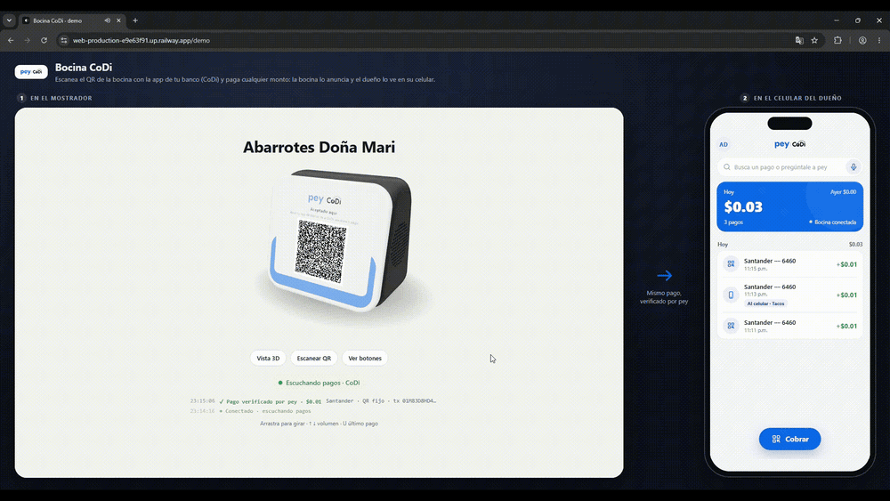

# Bocina CoDi

**Cobra con CoDi y escucha cada pago.** El cliente escanea el QR del mostrador, paga desde la app de su banco y, en cuanto pey confirma el dinero, la bocina lo dice en voz alta:

> "Recibiste 85 pesos."

Sin terminal, sin capturas de pantalla que revisar y sin instalar nada para el cliente. Y para el dueño, una app en el celular para ver cada pago al instante y cobrar a distancia.



Construido sobre la API de [pey](https://docs.pey.mx) para el Hackatón México 2026.

## Pruébalo en vivo, con un pago real

Esto no es una simulación: está en producción y cobra con CoDi de verdad a través de pey.

1. Abre el **[demo completo](https://web-production-e9e63f91.up.railway.app/demo)** en tu computadora y toca la bocina una vez para activar el sonido.
2. Escanea el QR de la bocina con la app de tu banco, en la sección **CoDi**.
3. Paga cualquier monto, por ejemplo **$1**.
4. En segundos la bocina dice **"Recibiste un peso"** y el celular del dueño imprime el comprobante con tu banco y la clave de rastreo.

El pago es real y llega a la cuenta del proyecto. También puedes abrir por separado la [bocina 3D](https://web-production-e9e63f91.up.railway.app/) o la [app del dueño](https://web-production-e9e63f91.up.railway.app/app).

---

## El problema

Son las dos de la tarde en una tiendita y hay fila. Un cliente paga con transferencia y le enseña su celular a Doña Mari: "ya quedó". Ella no tiene tiempo de abrir la app de su banco, así que confía en la captura de pantalla. Las capturas se pueden falsificar, y por eso muchos negocios todavía prefieren el efectivo.

CoDi existe desde 2019: transferencias inmediatas, sin terminal y sin comisión por tarjeta. Lo que le falta en el mostrador es responder, sin mirar ninguna pantalla, la única pregunta que importa: **¿de verdad me pagaron?**

## La solución: escucharlo

| Para el cliente | Para el tendero | Para el dueño |
|---|---|---|
| Escanea el QR con la app de su banco, pone el monto y paga. Nada que instalar. | Escucha "Recibiste 85 pesos" y sigue atendiendo. Nada que revisar. | Ve cada pago al instante en su celular, con el banco de quien pagó, y cobra a distancia. |

- **La bocina (`/`)**: lleva el QR fijo del negocio y anuncia cada pago en voz alta, uno por uno y en orden aunque lleguen varios a la vez. En el demo es un modelo 3D interactivo; en el roadmap, un aparato de bajo costo.
- **La app del dueño (`/app`)**: los pagos del día y del historial, cobros con monto exacto, cobro directo al celular del cliente y un asistente al que se le pregunta "¿cuánto vendí hoy?".

**La confirmación nunca viene del cliente.** Un pago solo se anuncia cuando pey envía el aviso con firma verificada ([Standard Webhooks](https://www.standardwebhooks.com/)). Una captura de pantalla no hace sonar la bocina.

## Cómo funciona

```
Cliente escanea el QR (o acepta el cobro en su celular) ──► paga desde su app bancaria (CoDi)
                                         │
                                         ▼
                       pey ──► POST /webhooks/pey
                                 ├─ verifica la firma
                                 ├─ descarta duplicados (webhook-id / transactionId)
                                 └─ guarda el pago
                                         │
                                  Server-Sent Events
                         ┌───────────────┴───────────────┐
                         ▼                               ▼
                 Bocina: "Recibiste 85 pesos"    App: comprobante y
                 + registro del pago             movimientos al instante
```

## Funcionalidades

**Bocina (mostrador)**
- QR fijo (`amount: 0`, sin expiración): el cliente ingresa el monto al pagar.
- Anuncio por voz de cada pago, con fila: si llegan varios pagos a la vez se anuncian uno por uno, completos y en orden.
- Bocina 3D interactiva: botones de volumen y repetir el último pago (también con teclado: ↑ ↓ y U); el LED indica el estado.
- Registro en vivo de los pagos verificados por pey y de la conexión; avisa en voz si se pierde la conexión.

**App del dueño**
- Total de hoy (y de ayer) y movimientos de los últimos 30 días agrupados por día, en tiempo real.
- Cada movimiento muestra el banco y los últimos 4 dígitos de la cuenta de quien pagó.
- Botón "Cobrar": muestra el QR fijo y permite agregar un monto para generar un QR con monto exacto.
- Cobro al celular: con el monto y el número del cliente, pey le envía el cobro CoDi a la app de su banco. Queda como pendiente con cuenta regresiva y se confirma al llegar el pago; si vence o falla, se puede reenviar o generar un QR con el mismo monto. Si una misma venta se paga dos veces, se marca como pago duplicado.
- Comprobante de "Pago recibido" con el monto en letra, el banco de origen y la clave de rastreo.
- Búsqueda de pagos y asistente por texto o voz en la misma barra: "¿Cuánto vendí hoy?", "Cóbrale 90 de dos tortas".
- Perfil con Mi QR para compartir como imagen, cuenta de depósito y ajustes de sonido.
- Ajustes avanzados protegidos con PIN, con el estado del servidor (incluye si el historial está en almacenamiento persistente).
- Instalable como app (PWA).

**Demo (`/demo`)**
- La bocina y la app del dueño lado a lado, reaccionando al mismo pago.

## Stack

- **Backend:** Python, FastAPI, SQLite, Server-Sent Events.
- **Pagos:** API de pey (CoDi), webhooks firmados con Standard Webhooks.
- **Voz:** ElevenLabs (texto a voz) con respaldo en la voz del navegador; Web Speech API para dictado.
- **Asistente:** LLM vía API de Anthropic (opcional; sin llave funciona con reglas simples).
- **Frontend:** HTML, CSS y JavaScript sin frameworks.

## Estructura

```
app/
  main.py            API, webhook de pey, SSE, voz y asistente
  static/
    index.html       Mostrador: bocina 3D interactiva
    app.html         App del dueño
    demo.html        Demo: bocina y app lado a lado con el mismo pago
    soundbox-display.js  Modelo 3D de la bocina (three.js)
    pey-codi.svg     Logo pey · CoDi
    vendor/three/    three.js r170
    common.js        Fila de voz, eventos en vivo y utilidades compartidas
    icon.svg
docs/demo.gif        GIF del demo para este README
requirements.txt
Procfile             Comando de arranque
railway.json         Configuración de despliegue en Railway
.env.example         Variables de entorno
```

## Correr en local

Requisitos: Python 3.12+ y una cuenta en [pey](https://portal.pey.mx).

```bash
python -m venv .venv
source .venv/bin/activate        # Windows: .venv\Scripts\activate
pip install -r requirements.txt
cp .env.example .env             # agrega tu PEY_API_KEY
uvicorn app.main:app --reload --port 8000
```

- Bocina: http://localhost:8000
- App del dueño: http://localhost:8000/app
- Demo: http://localhost:8000/demo

### Conectar el webhook

pey necesita una URL pública para avisar de los pagos. En local puedes usar un túnel:

```bash
ngrok http 8000        # o: cloudflared tunnel --url http://localhost:8000
```

1. En [portal.pey.mx](https://portal.pey.mx) → **Desarrollador** → ⚙︎ de tu API key, registra `https://<tu-url>/webhooks/pey`.
2. Copia el secreto (`whsec_...`) en `PEY_WEBHOOK_SECRET` y reinicia el servidor.
3. Haz un pago de prueba. Si no llega, revisa los **Logs de Webhook** del portal.

## Variables de entorno

| Variable | Requerida | Descripción |
|---|---|---|
| `PEY_API_KEY` | Sí | API key de pey |
| `PEY_WEBHOOK_SECRET` | Sí | Secreto del webhook (`whsec_...`) |
| `BUSINESS_NAME` | No | Nombre que ve el cliente al pagar |
| `DEPOSIT_ACCOUNT_LABEL` | No | Cómo se muestra en el perfil la cuenta donde cae el dinero, ej. `BBVA ···· 2702` |
| `PUSH_EXPIRATION` | No | Segundos que dura una solicitud de cobro al celular (mínimo 360; por defecto 900) |
| `FIXED_QR_ID` / `FIXED_QR_STRING` | No | Amarra el QR fijo a la cuenta; sobrevive reinicios y deploys |
| `ADMIN_PIN` | Recomendada | PIN para entrar a Ajustes avanzados |
| `ELEVENLABS_API_KEY` / `ELEVENLABS_VOICE_ID` | No | Voz natural; sin llave se usa la voz del navegador |
| `ANTHROPIC_API_KEY` | No | Asistente con lenguaje natural; sin llave usa reglas |
| `DEFAULT_EXPIRATION` | No | Expiración de los QR con monto en segundos (0 = no expira; mínimo 360) |
| `DB_PATH` | No | Ruta de la base SQLite (en Railway: `/data/bocina.db`) |
| `ALLOW_SIMULATION` | No | Permite simular pagos para pruebas; dejar en `false` en producción |

## Despliegue

El servidor necesita un proceso siempre activo (para los eventos en vivo) y un disco persistente (para SQLite), por lo que se despliega en [Railway](https://railway.com) en lugar de una plataforma serverless.

1. **New Project → Deploy from GitHub repo** y selecciona este repositorio. El comando de arranque se toma de `railway.json`.
2. En el servicio, agrega un **Volume** montado en `/data` (sin volumen, el historial se borra en cada despliegue; la app lo avisa en Ajustes avanzados).
3. En **Variables**, pega el contenido de tu `.env` (Raw Editor) y define `DB_PATH=/data/bocina.db`.
4. En **Settings → Networking**, genera un dominio público.
5. Actualiza la URL del webhook en el portal de pey a `https://<tu-dominio>/webhooks/pey`.

## API

| Método | Ruta | Descripción |
|---|---|---|
| `POST` | `/webhooks/pey` | Recibe pagos de pey (firma verificada e idempotencia) |
| `GET` | `/api/events` | Eventos en vivo (SSE) |
| `GET` | `/api/fixed-qr` | QR fijo activo |
| `POST` | `/api/fixed-qr` | Crea un QR fijo nuevo (requiere PIN) |
| `POST` | `/api/charges` | Crea un QR con monto |
| `POST` | `/api/push` | Envía un cobro CoDi al celular del cliente |
| `POST` | `/api/push/{id}/dismiss` | Quita de la lista un cobro al celular pendiente |
| `GET` | `/api/payments` | Pagos, cobros al celular pendientes y totales de hoy y ayer |
| `GET` | `/api/last-payment` | Último pago, con la frase para anunciarlo |
| `POST` | `/api/assistant` | Asistente: responde sobre las ventas o genera un cobro |
| `POST` | `/api/tts` | Texto a voz |
| `GET` | `/api/status` | Estado de la configuración |

## Roadmap

- **Bocina física de bajo costo** (ESP32 + bocina + WiFi) conectada al mismo flujo de eventos.
- **Enlace de pago** para compartir por WhatsApp, como respaldo cuando el cliente no tiene CoDi ligado a su número.
- **Ajustes de la bocina desde la app:** voz y volumen guardados en el servidor, para controlar la bocina del mostrador desde el celular.
- **Varios negocios:** alta con nombre y cuenta propios, en lugar de un solo negocio configurado por variables de entorno.
